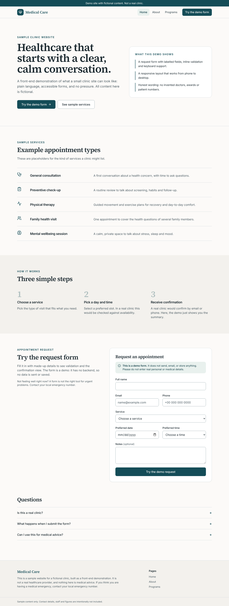
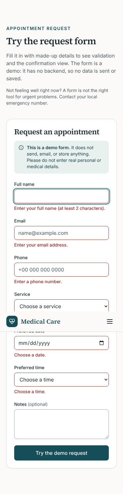

# Medical Care (sample clinic website)

A sample marketing and appointment-request website for a **fictional** clinic. It demonstrates a calm, accessible healthcare-style UI built with Next.js. It is not a real healthcare provider and nothing on it is medical advice.

Live demo: https://medical-care-eta.vercel.app (deployment from the original repo; it may not reflect the latest changes on this branch).




## Pages

- `/` Home: sample services, how it works, demo request form, FAQ
- `/about` About this sample site and its design principles
- `/projects` Example care programs (route kept from the original; shown as "Programs")

## The appointment form is a demo

The form validates input in the browser (React Hook Form + Zod) and then shows an on-screen summary. It makes **no network request**. The entry is held in Redux state in memory for that tab only and disappears on reload. The UI says this on the form itself. No email is sent and no data is stored.

## Demo data

All content (services, programs, form options) is placeholder text. Invented doctors, statistics, awards, contact details and stock photos from the earlier version were removed rather than kept.

## Stack

Next.js 13 (App Router, static export), TypeScript, Tailwind CSS, shadcn/ui primitives (many generated components are present but unused), React Hook Form, Zod, Redux Toolkit, lucide-react. Fonts (Inter, Source Serif 4) are self-hosted through `@fontsource-variable` packages, so the build needs no network access to Google Fonts.

## Run

```bash
npm ci
npm run dev        # http://localhost:5231
npm run build      # static export to ./out
npm run preview    # serves ./out on http://localhost:5231
npm run lint
npm run typecheck
```

No environment variables are required.

## Verification

On this branch I ran `npm run lint`, `npx tsc --noEmit` and `npm run build` (all passed), served `out/` and exercised the pages and form with Playwright at 1280x800 and 390x844 (no console errors, no horizontal overflow at 390px, validation errors and success view rendered). GitHub Actions runs lint, typecheck and build on every push (`.github/workflows/ci.yml`); I have not seen that workflow run on GitHub.

## Known limitations

- No backend, so no real booking, email, or persistence.
- No automated tests; verification was manual plus lint, typecheck and build.
- The `@next/swc-wasm-nodejs` dependency was removed because the build works with the native SWC binary on Linux x64. It was not tested on other platforms.
- Accessibility was reviewed by hand and with keyboard use in a browser, not with a screen reader or an automated audit tool.
- No dark mode.

## Notes

UI and code quality improvements were made with AI assistance (Claude, Anthropic), reviewed and verified by building and running the app.
